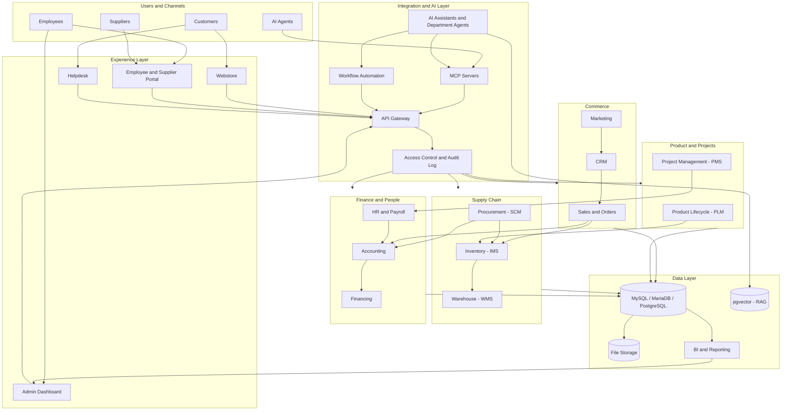

> https://syazskylex.github.io/

# About Me

> Developer, systems builder, and AI automation enthusiast focused on turning complex workflows into practical, self-hosted products.

Hi, I'm **Syaz Skylex** - **Syazani Tarmidi**. I work across backend engineering, web platforms, infrastructure, and AI integration. I enjoy connecting systems that are usually separate (commerce, internal operations, employee tools, automation, and AI agents) into coherent workflows.

This README is a public-facing overview of my technical interests and ongoing areas of work. It intentionally leaves out private financial, health, location, account, and infrastructure details.

## What I Work On

- **Backend and web engineering:** PHP applications, MVC architecture, APIs, and business systems.
- **Commerce and operations:** e-commerce platforms, ERP-style workflows, employee portals, and unified business operations.
- **AI agents and automation:** tool-using assistants, MCP integrations, agent workflows, and autonomous task execution.
- **Self-hosting and deployment:** Docker-based applications, deployment platforms, reverse proxies, and private services exposed securely.
- **Developer experience:** admin panels, editors, visual builders, responsive interfaces, and streamlined workflows.

## Core Technical Interests

### Backend Development

- PHP 8.x
- Laravel (including Livewire)
- CodeIgniter
- Odoo integrations
- Custom MVC architectures and framework integrations
- REST APIs and service integrations
- MySQL / MariaDB and PostgreSQL
- Composer and application deployment

I have experience working with Laravel and CodeIgniter based systems, including a custom architecture that brings framework components together. I'm particularly interested in maintainable business applications and practical ways to extend existing codebases without rebuilding everything from scratch.

### Frontend and UI

- HTML, CSS, and JavaScript
- Tailwind CSS
- daisyUI
- Flux UI
- Bootstrap
- jQuery
- Lucide icons
- Animate.css
- Responsive web interfaces and admin dashboards
- Interactive HTML dashboards and CSS effects such as glassmorphism
- Monaco Editor and visual page-building tools
- Shopify / Liquid theme customization and cart scripting

My UI preference is generally **minimal, clear, responsive, and product-focused**, with an Apple/iOS-inspired feel where appropriate. I value interfaces that work well on both desktop and mobile without unnecessary complexity.

### Infrastructure and Self-Hosting

- Docker and Docker Compose
- Dokploy (including Railpack builds, e.g. Statamic installs)
- Cloudflare Tunnel and DNS
- Linux server administration
- Apache and PHP hosting
- MySQL / MariaDB
- PostgreSQL
- Self-hosted business applications
- Deployment scripts, persistent storage, scheduled jobs, and service integration
- Email delivery (SMTP / OAuth) debugging across PHP and Odoo

I prefer solutions that can be deployed and maintained realistically. When possible, I look for reusable deployment templates and integrated management rather than a pile of manually configured services.

### AI, Agents, and MCP

I'm interested in moving beyond chat-only AI toward systems that can actually perform useful work.

Areas I explore include:

- AI assistants that use tools and APIs
- Model Context Protocol (MCP) servers and integrations
- Multi-agent and department-specific workflows
- Autonomous task execution with appropriate controls
- AI coding agents that can work with files, terminals, browsers, and Git
- OpenAI-compatible model gateways and provider routing
- Local LLMs and Apple Silicon inference
- Self-hosted AI interfaces and agent runtimes (Open WebUI, Ollama, and similar)
- RAG and vector search with PostgreSQL / pgvector
- Connecting AI to ERP, commerce, CRM, employee portals, and internal services
- AI policy work, such as content moderation guidelines

My goal is to make AI useful as an operational layer for a business, not merely a chatbot window.

## Local AI and Model Infrastructure

I explore both hosted model providers and local inference. I'm interested in comparing models based on practical capability rather than hype, especially:

- Tool calling and reliable structured outputs
- Vision support
- Long context windows
- Coding quality
- Latency and throughput
- Memory requirements and quantization
- Cost and deployment complexity

## How I Like to Build

- **Practical over fashionable:** choose tools based on whether they solve the problem.
- **Reuse before reinventing:** evaluate existing projects and integrations before creating a new platform.
- **Validate demand:** do not build a large product before establishing that people need it.
- **Automation-first:** reduce repetitive manual work wherever it is safe and worthwhile.
- **Self-hosting where useful:** value control over deployment, data, and integrations.
- **Modular architecture:** keep components replaceable and integrations explicit.
- **Useful autonomy:** let agents do real work, with permissions and safeguards appropriate to the task.
- **Simple UX:** prefer clear, responsive interfaces over unnecessary visual complexity.
- **End-to-end thinking:** consider the application, deployment, integrations, and operational workflow together.

## Current Areas of Exploration

These are ongoing interests, not necessarily finished or publicly released products:

- A unified business operations platform around MixSwift
- A native, drag-and-drop system builder (Laravel + Livewire + Tauri / NativePHP)
- Self-hosted AI workspaces for employees
- MCP-based integrations for business applications
- Autonomous AI workflows and coding agents
- PHP/Laravel-oriented application hosting and deployment templates
- E-commerce, ERP, and CMS integration (including Statamic on Dokploy)
- Local LLM inference and model routing
- Browser-based administration and developer tools

## Technology Map

A non-exhaustive list of technologies and ecosystems I work with or explore:

| Area | Technologies / Projects |
|---|---|
| Backend | PHP, Laravel, Livewire, CodeIgniter, Odoo, Composer |
| Databases | MySQL, MariaDB, PostgreSQL, pgvector |
| Frontend | JavaScript, jQuery, Tailwind CSS, daisyUI, Flux, Bootstrap, Vite |
| UI tooling | Lucide, Animate.css, Monaco Editor |
| CMS / Commerce | WooCommerce, Shopify (Liquid), Statamic |
| Desktop / native | Tauri, NativePHP |
| Deployment | Docker, Docker Compose, Dokploy |
| Infrastructure | Linux, Apache, Cloudflare Tunnel |
| AI integration | MCP, APIs, OpenAI-compatible endpoints, agent runtimes, Open WebUI |
| Local AI | Apple Silicon, MLX, Ollama, llama.cpp, LM Studio |
| Knowledge tooling | Obsidian |
| Business systems | E-commerce, ERP workflows, employee portals, CMS |

This table reflects areas of experience and exploration; it is not intended to imply equal production-level expertise in every listed tool.

## What I'm Interested In

I am especially interested in projects that combine several of these themes:

- Self-hosted business software
- AI agents that can use tools safely
- Open-source infrastructure and deployment
- Commerce and operational automation
- Practical developer tools
- Systems integration and API design
- Making complex workflows easier for teams

---

*This profile is a snapshot of my interests and technical direction. Projects, tools, and priorities may change over time.*
